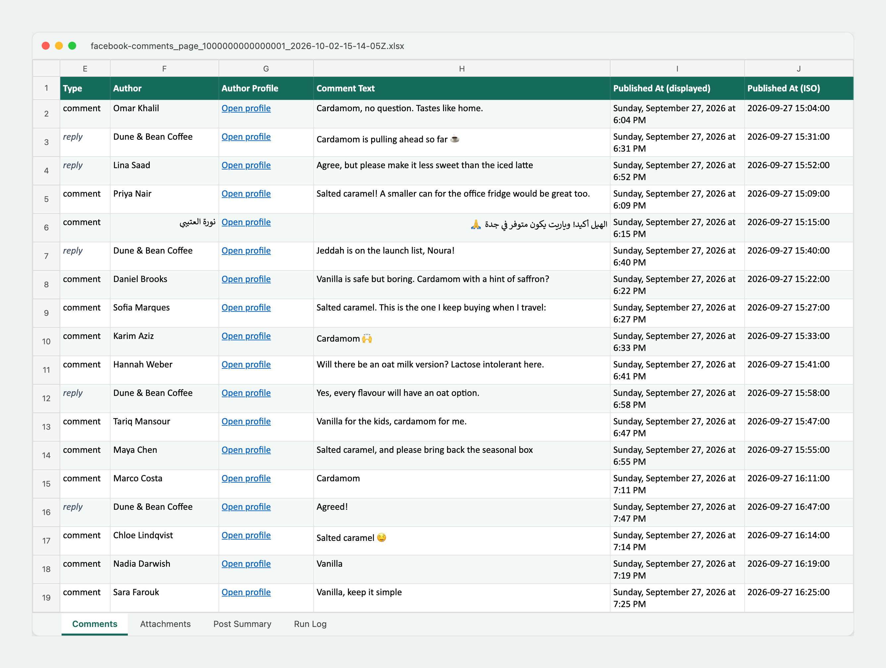

# Saysheet: export a post's comments to a spreadsheet

Saysheet is a Chrome extension that copies every comment and reply you can see on a Facebook or LinkedIn post into an organized Excel workbook. It runs on your computer with your normal login, and it deletes what it collected once the Excel file is saved. The name joins "say" with "sheet", because it turns what people say under a post into a spreadsheet.



## The problem

Getting a post's comments out of Facebook or LinkedIn is harder than it should be:

- Neither Facebook nor LinkedIn has a button that exports a post's comments.
- Meta retired its Groups API in 2024, so an app can't take a group post link and fetch the comments.
- Both sites load comments a few at a time, hide replies behind "View replies" buttons, and show "Most relevant" comments first. Copying by hand is slow on a post with hundreds of comments and still misses some.
- LinkedIn says some comments only appear when the list is sorted by "Most recent".
- Copy and paste loses who replied to whom, along with dates and reaction counts.

## Who it's for

Anyone who needs the comments on a post as rows they can sort, filter and count. For example:

- A marketer counting votes or entries on a giveaway or poll post.
- Someone who posted "comment GUIDE and I'll send it to you" on LinkedIn and needs the list of people who asked.
- Product and research teams reading what customers said about a launch, in any language.
- Community managers keeping a record of a discussion.

I built it to get the comments on a Facebook group post into a spreadsheet, then added LinkedIn the same day.

## What it does

- Detects the post in the current tab, or takes a pasted link, and strips tracking parameters from it.
- Offers two modes. Assisted collection switches the sort order to show every comment, scrolls the comments panel, opens every "more comments" and "View replies" control, and expands truncated text. Manual scan exports only what's already on screen, for people who'd rather load comments themselves.
- Shows progress on a dashboard in its own tab, with pause, resume, stop and finish controls, and can export a partial result.
- Saves a workbook with four sheets. **Comments** has one row per comment or reply with the author, profile link, text, date, reactions, reply count, a link to the comment and any attachments. **Attachments** has a clickable link for each image, video or link. **Post Summary** records the post, the counts and how the collection ended. **Run Log** lists warnings and retries.
- Keeps each reply under the comment it answers, with a parent ID and depth so the thread can be rebuilt.
- Handles comments in any language, including Arabic and other right-to-left scripts.
- Deletes the collected comments from the extension as soon as Chrome confirms the Excel file has been saved.

A [sample workbook](docs/sample-export.xlsx) made from a made-up post shows the full output.

## Product decisions

### A browser extension, because the API route is closed

With the Groups API gone, there's no official way for an app to read the comments on an arbitrary group post. A Chrome extension reads the post the way you do, in a tab where you're already logged in, so it works on any post your account can see.

### Local only, with no login or token

The extension never asks for a password or an access token, has no server, and doesn't call either site's private APIs. It reads the page open in your tab. Collected comments sit in the extension's own storage only until Chrome confirms the Excel download, and then they're deleted. Commenters' names and words are personal data, so keeping them on one machine for as short a time as possible was a requirement from the start.

It also asks for no site access up front. Chrome lets it into a tab only when you click its toolbar button. It asks for Facebook or LinkedIn access only when you paste a link to a post that isn't already open.

### A permission check before automatic collection

Assisted collection clicks and scrolls on the page for you. The first time you choose it, the popup asks you to confirm that you have permission and a lawful basis to export the comments. Manual scan stays available as the lighter option.

### Sort order chosen for completeness

Facebook's default "Most relevant" view leaves comments out, so assisted mode switches to "All comments". On LinkedIn it picks "Most recent", because LinkedIn documents that some comments only show there. If the switch fails, the job pauses and asks you to choose the option yourself instead of carrying on with an incomplete list.

### Pause as partial instead of claiming it's done

A collection only counts as complete after the comments panel has stayed at the bottom with nothing new for 60 seconds while the post tab is visible. If the post's comment count is still higher than what was collected, it waits 120 seconds. Each "load more" control gets two tries of up to 45 seconds. If something is still missing after that, the job pauses and is marked partial. You can resume to retry or finish to export what you have, and the Run Log says what was missing. This came from asking what happens on a slow connection, where a single reply can take 30 seconds to load.

### Links to media instead of embedded files

Images and videos in comments are listed as clickable links on the Attachments sheet instead of being embedded, which would make the workbook huge. Profile pictures and reaction icons are left out. The cost is that Facebook and LinkedIn media links can expire, so important media should be opened or saved soon after export.

### Finding comments by what changes least

Both sites rename their CSS classes often. The collectors find comments through things that stay stable: ARIA roles and labels, Facebook comment permalinks and LinkedIn comment IDs. Those IDs also remove duplicates, since both sites can show the same comment again as you scroll.

### Cells that are safe to open

Comment text that starts with `=`, `+`, `-` or `@` gets a leading apostrophe so Excel won't treat it as a formula. Text longer than Excel's 32,767-character cell limit continues in overflow columns.

## What changed after testing

I tested each version on a real Facebook group post and a real LinkedIn post and turned what broke into the next round of work. Most fixes came with an automated test so the problem can't quietly come back.

| Round | What I saw | Cause | What changed |
|---|---|---|---|
| 1 | Collection stopped long before it had every comment and reply | It finished as soon as no "load more" button was visible, but Facebook loads more comments as you scroll its comments panel. When it stopped, 595 comments and replies were loaded and the panel was still about 8,000 pixels from the bottom | It scrolls the comments panel, saves each batch as it loads, and checks the bottom repeatedly before finishing |
| 2 | Assisted mode didn't switch to "All comments", and the dashboard asked me to do it | Facebook's menu item reads "All comments" followed by "Show all comments, including potential spam" as one label, and the extension looked for an exact match. It could also click before the menu had opened | It matches the start of the label, waits for the menu to appear, and confirms the new sort before carrying on |
| 3 | I asked whether a slow connection could make it stop early | Completion was decided after a few short checks at the bottom | The 60 and 120 second quiet periods, two 45-second tries per loader, and pausing as partial instead of reporting completion |
| 4 | I asked whether images and videos in comments end up in the file | Attachment links were stored only inside the comment row | A separate Attachments sheet with a clickable link for each image, video and link |
| 5 | On LinkedIn it didn't switch to "Most recent" on its own. After I switched it myself and clicked Resume, nothing happened | LinkedIn only shows the sort control after the first "See more comments" is opened, and the collector looked for it before that. A paused run could also end just as Resume arrived, so Resume was acknowledged but nothing restarted | It opens the comments first, then picks "Most recent". The paused run stays alive so Resume continues it, and the total comment count is no longer mistaken for a "load more" button |
| 6 | While I prepared the sample workbook for this page, the "Published At (ISO)" column was empty | Chrome can't read Facebook's date format, "Friday, August 21, 2026 at 11:34 AM", because of the word "at". Every Facebook export had dates only as text, which sort by weekday name | The word "at" is removed before the date is read, and a test checks the result |

## How quality is checked

The requirements became 27 automated tests. `npm run check` runs them along with a TypeScript check and a production build. The tests use HTML modeled on each site's page structure, so they never touch Facebook or LinkedIn. They cover these requirements:

- Links are recognized. Facebook group, Page, profile, photo, video and reel links and both LinkedIn link formats are accepted with tracking parameters removed. Feeds, group home pages, profiles, job pages and unresolved share links are rejected.
- Only the target post's comments are collected, never comments from other posts on the page.
- Threads stay intact. Replies keep their parent, and authors, text, reactions, attachment links and Facebook dates come through.
- Loading controls are found in the right order. Sort options are recognized even with a description after the name, and a "Most recent" option inside a hidden menu is never clicked.
- Security checks and CAPTCHAs pause the job instead of being clicked through.
- The workbook is safe and complete. Formula-like text is neutralized, oversized text is split, all four sheets are written, and a 10,000-row export finishes.

Rounds 1 to 5 came from using the extension on live posts.

## Limitations

- It only sees what your account can see. Deleted, hidden, moderated and restricted comments can't be collected, and a post's comment count can include comments you can't view.
- The Facebook or LinkedIn interface has to be in English, because the extension finds buttons by their labels. Comment text can be in any language.
- The post tab has to stay open and visible until the job finishes. Chrome slows down hidden tabs, and the quiet-period timer only counts while the tab is visible.
- LinkedIn usually shows relative times such as "2h". Those are exported as shown, without an exact date.
- Media isn't embedded, and media links can expire.
- When either site changes its page structure, assisted mode can break until the collector is updated. Manual scan often keeps working in the meantime.

Assisted collection is automated access, which Meta's and LinkedIn's terms restrict. Use the extension only on posts you're allowed to process, where you have a lawful basis for handling commenters' personal data. See [Meta's guidance on scraping](https://www.facebook.com/help/463983701520800) and [LinkedIn's help on comments](https://www.linkedin.com/help/linkedin/answer/a524166/commenting-on-posts-and-comments).

## Ideas for what's next

- A summary sheet for campaign posts: counts by keyword for votes and "comment to get it" posts, top commenters, and comments over time.
- Exact dates for LinkedIn comments.
- Several posts in one job, such as every post in a campaign, into one workbook.
- Grouping comments by topic and sentiment, so a long thread can be read in a few minutes.

## My role

I defined the problem and the requirements, made the product decisions at each step, tested it on real Facebook and LinkedIn posts, and decided what to fix next. The code was written with Codex, an AI coding assistant, working from those requirements and my test feedback. It was built in one evening on 2 September 2026, with Facebook first and LinkedIn after. The date fix in round 6 was made with Claude Code while I prepared this write-up.

## Try it

You need Chrome and Node.js 22 or newer.

1. Download this repository (**Code** > **Download ZIP**, then unzip it) or clone it.
2. In the project folder, build the extension:

   ```sh
   npm install
   npm run build
   ```

3. Open `chrome://extensions`, turn on **Developer mode** (top right), click **Load unpacked** and choose the `dist/chrome-mv3` folder.
4. Optional: pin the extension from the puzzle-piece menu so its button is always visible.

Then:

1. Log in to Facebook or LinkedIn as usual and open the post itself, not the feed. On Facebook that's the post's own link; on LinkedIn it's a `/posts/…` or `/feed/update/urn:li:activity:…` link.
2. Click the extension's button. It fills in the post link, or you can paste one.
3. Choose **Assisted collection** and click **Start assisted collection**. A dashboard opens in a new tab.
4. Keep the post tab open and visible until the dashboard says the collection is complete.
5. Click **Download Excel**. To export early, click **Stop** or **Finish collection** first.

Facebook group, Page, profile, photo, video and reel posts are supported.


## Permissions

- `activeTab` and `scripting` add the matching collector to the tab only after you click the extension.
- `storage` remembers that you confirmed the permission check and which download belongs to which collection.
- `downloads` saves the `.xlsx` file and lets the extension delete its temporary data only after Chrome reports the download finished.
- Optional Facebook or LinkedIn access is requested only when you paste a link to a post that isn't open, so the extension can open it and start.

## Troubleshooting

- **No post detected:** open the post's own link, not a home feed, group home page, profile, job or unresolved share link.
- **Facebook sorting pause:** choose **All comments** yourself, then click **Resume**.
- **LinkedIn sorting pause:** keep the post tab visible and click **Resume**. The extension reopens the comments and tries **Most recent** again.
- **Only some comments appear:** keep the post tab visible and check the Run Log sheet for a comment-count mismatch or a failed loader.
- **The site's layout changed:** manual scan may still export the comments on screen until the collector is updated.

## More

- Development: `npm run dev` opens a development browser, `npm test` runs the tests, and `npm run check` runs the type check, tests and build. The page parsing for each site lives in `lib/collector/dom.ts` (Facebook) and `lib/collector/linkedin-dom.ts` (LinkedIn).
- The screenshots and the sample workbook use a made-up post and made-up names. The workbook and its screenshot come from the extension's own export code.
- License: [MIT](LICENSE).
